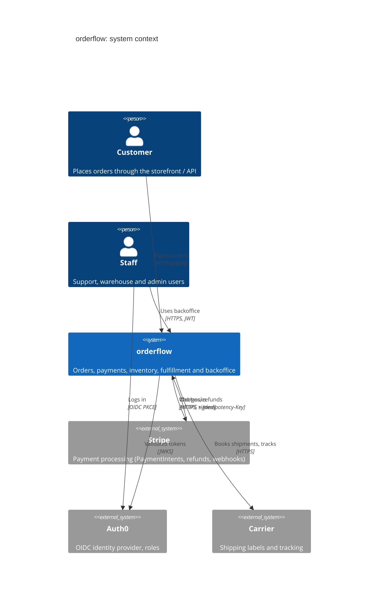
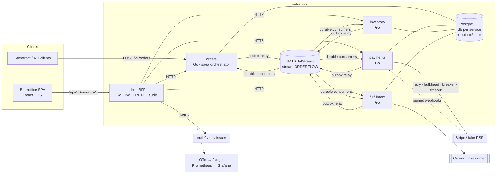
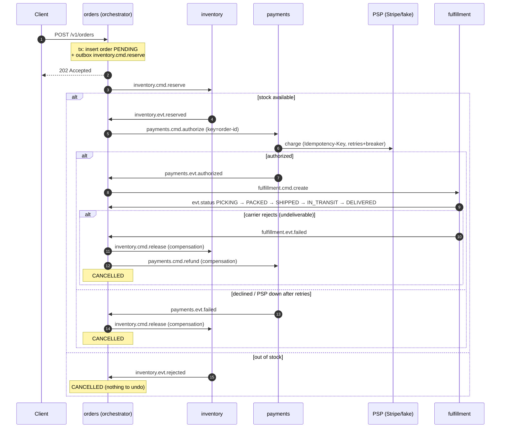
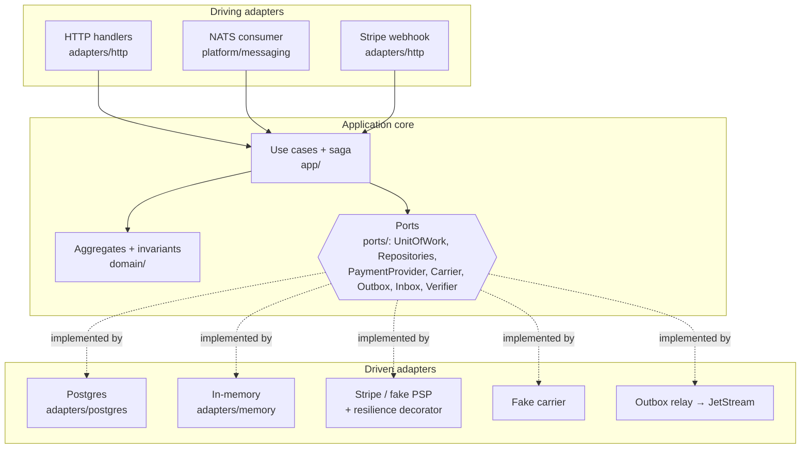

# orderflow

**A production-shaped e-commerce order, payment and fulfillment platform in Go.** It is built to show system design rather than CRUD: hexagonal services, a saga with compensations, a transactional outbox and an idempotent inbox, resilience patterns you can watch working under injected failures, Stripe and Auth0 integrations, a TypeScript backoffice, and the platform around it (OpenTelemetry, Prometheus/Grafana SLOs, Helm, Terraform for AWS, CI).

```
Go 1.26 · NATS JetStream · PostgreSQL · OpenTelemetry · Prometheus · Grafana · Jaeger
Stripe (PaymentIntents, webhooks) · Auth0 / OIDC · React + TypeScript · Helm · Terraform (EKS, RDS) · k6
```

`make up` starts the whole stack. `scripts/chaos.sh payments-decline` breaks payments, and the saga undoes the stock reservation in front of you.

---

## Contents
- [What it does](#what-it-does)
- [Architecture](#architecture)
- [Resilience patterns and where they live](#resilience-patterns-and-where-they-live)
- [Quickstart](#quickstart)
- [Demo walkthrough](#demo-walkthrough)
- [Integrations: Stripe and Auth0](#integrations-stripe-and-auth0)
- [Observability and SLOs](#observability-and-slos)
- [Testing](#testing)
- [Deployment](#deployment)
- [Decisions (ADRs)](#decisions-adrs)

## What it does

A customer places an order. The platform reserves stock, charges the card, picks, packs and ships the goods through a carrier, and tracks the shipment until it is delivered. When any step fails, the steps that already succeeded are compensated: reserved stock is released and a captured payment is refunded. Staff use a backoffice to search orders, see the saga timeline, issue refunds, work the fulfillment queue and adjust inventory. Every action is gated by role and written to an audit log.

| Service | Responsibility | Port (compose) |
|---|---|---|
| `orders` | Order aggregate + **saga orchestrator** | 8080 |
| `payments` | Payments, idempotency keys, Stripe/fake PSP adapters, Stripe webhooks | 8081 |
| `inventory` | Stock per SKU, reservations, audited adjustments | 8082 |
| `fulfillment` | Pick → pack → ship (carrier port) → tracking events | 8083 |
| `admin` | Backoffice **BFF** (JWT + RBAC + audit log) serving the React SPA | 8088 |
| `payprovider` | PSP simulator with runtime-controllable latency, 5xx, declines and outage | 8090 |
| `devissuer` | Local OIDC issuer (JWKS + demo users) standing in for Auth0 | 9000 |

## Architecture

### C4: system context



### C4: containers



### Saga: happy path and compensations



Every arrow above is a message that is written to an **outbox** in the same transaction as the state change, relayed to JetStream, and consumed through an **inbox** that drops duplicates. See [ADR 0002](docs/adr/0002-transactional-outbox.md) and [ADR 0003](docs/adr/0003-saga-orchestration.md).

### Hexagonal layers (each service)



```
cmd/<service>/main.go              composition root (wires adapters into ports)
internal/<service>/domain          aggregates: Order, Payment, Item/Reservation, Shipment
internal/<service>/ports           driven ports (interfaces)
internal/<service>/app             use cases; orders/app is the saga orchestrator
internal/<service>/adapters/...    http, postgres, memory, provider, stripe, carrier
internal/contracts                 published language: subjects + payloads
internal/platform/...              outbox, messaging (JetStream), resilience, auth, httpx, observability, bootstrap
web/                               backoffice SPA (React + Vite + TypeScript)
deploy/                            compose assets, Grafana, Prometheus rules, Helm chart, Terraform
```

## Resilience patterns and where they live

| Pattern | What it protects | Code |
|---|---|---|
| Transactional outbox | no lost or phantom messages (no dual write) | [`platform/pg/pg.go`](internal/platform/pg/pg.go) `Outbox`, [`platform/outbox/relay.go`](internal/platform/outbox/relay.go) |
| Idempotent consumer (inbox) | at-least-once delivery without double effects | `pg.Inbox`, `MarkProcessed` calls in every `app/service.go` |
| Broker deduplication | relay re-publish after a crash | `jetstream.WithMsgID` in [`platform/messaging/nats.go`](internal/platform/messaging/nats.go) |
| Saga with compensations | cross-service consistency | [`orders/app/service.go`](internal/orders/app/service.go), `Order.Cancel` in [`orders/domain/order.go`](internal/orders/domain/order.go) |
| Idempotency keys (API + PSP) | no double charge on client or saga retries | [`payments/app/service.go`](internal/payments/app/service.go), [`payments/adapters/http/http.go`](internal/payments/adapters/http/http.go) |
| Circuit breaker | fail fast while the PSP is down; business declines do not trip it | [`platform/resilience/breaker.go`](internal/platform/resilience/breaker.go), wired in [`payments/adapters/provider/resilient.go`](internal/payments/adapters/provider/resilient.go) |
| Retry, exponential backoff + full jitter | transient 5xx/timeouts without thundering herds | [`platform/resilience/retry.go`](internal/platform/resilience/retry.go); carrier booking in [`fulfillment/app/service.go`](internal/fulfillment/app/service.go) |
| Timeouts | per-attempt PSP timeout, consumer handler deadline, HTTP server timeouts, BFF client timeout | `resilient.go`, `nats.go`, `bootstrap.go`, `admin/adapters/clients` |
| Bulkhead | caps concurrent PSP calls | [`platform/resilience/bulkhead.go`](internal/platform/resilience/bulkhead.go) |
| Rate limiting (per client, 429 + Retry-After) | protects every service's API | [`platform/resilience/ratelimit.go`](internal/platform/resilience/ratelimit.go) |
| Redelivery with backoff + dead-lettering | poison or permanently failing messages | `Subscribe` in `nats.go` (`MaxDeliver`, `NakWithDelay`, `Term`) |
| Optimistic / pessimistic locking | concurrent saga replies; overselling | `version` check in `orders/adapters/postgres`; `FOR UPDATE` in SKU order in `inventory` |
| Graceful shutdown | readiness flips to 503, LB drain delay, HTTP drain, consumer drain, relay stop | [`platform/httpx/httpx.go`](internal/platform/httpx/httpx.go) `Serve`, `bootstrap.go` |
| Health / readiness probes | `/healthz` liveness, `/readyz` checks Postgres + NATS | `httpx.Probes`; Helm startup/liveness/readiness probes |
| Failure injection | proves all of the above | [`payprovider`](internal/payprovider/payprovider.go), fake carrier, [`scripts/chaos.sh`](scripts/chaos.sh) |

## Quickstart

Requirements: Docker with Compose v2. Go 1.26+ and Node 20+ are only needed to run the tests outside Docker.

```bash
cp .env.example .env          # defaults: fake PSP + local dev issuer, no external accounts needed
make up                       # builds and starts 12 containers
curl -s localhost:8080/readyz # {"nats":"ok","postgres":"ok"}
```

| URL | What |
|---|---|
| http://localhost:8088 | Backoffice (log in as admin / support / viewer) |
| http://localhost:3000 | Grafana: *orderflow · services & SLOs* |
| http://localhost:16686 | Jaeger traces |
| http://localhost:9090 | Prometheus (+ SLO rules and alerts) |
| http://localhost:8222 | NATS monitoring |

## Demo walkthrough

```bash
# 1. Happy path: follow one order through every saga step
scripts/place-order.sh alice SKU-KEYBOARD 1
#   -> PENDING -> PAID -> SHIPPED -> DELIVERED
#   14:09:31  order placed
#   14:09:31  stock reserved
#   14:09:32  payment authorized   a73f391e-...
#   14:09:35  fulfillment picking
#   14:09:41  shipped              FAKEX FX0622422095
#   14:09:47  delivered

# 2. Payment declined: the saga releases the reserved stock
scripts/chaos.sh payments-decline
#   14:09:51  cancelled  payment failed: payment declined: card_declined
#   14:09:51  compensation: release stock

# 3. Carrier rejects the address after payment: stock released AND card refunded
scripts/chaos.sh undeliverable
#   cancelled  fulfillment failed: carrier rejected shipment: address not serviceable
#   compensation: release stock
#   compensation: refund payment

# 4. Kill the payments service mid-saga: the command waits durably in JetStream
scripts/chaos.sh kill-payments
#   -> STOCK_RESERVED   (payments down)
#   -> PAID -> SHIPPED -> DELIVERED   (after restart, nothing lost)

# 5. PSP outage: retries run out, the breaker opens and later orders fail fast
scripts/chaos.sh provider-outage
#   payment failed: provider unavailable: circuit breaker is open
#   orderflow_circuit_breaker_state{name="fakepsp"} 2

# 6. Flaky PSP (60% 5xx + latency): retries with jitter absorb it
scripts/chaos.sh provider-flaky

# 7. Load test with SLO thresholds (p99 < 300 ms, < 1% errors) + idempotency checks
make load
```

**Backoffice tour** (http://localhost:8088):
1. Log in as **vera.viewer**. You can browse orders and the fulfillment queue, but there are no refund or adjust buttons, and the API returns `403` if you try anyway.
2. Log in as **sam.support**. Open a `DELIVERED` order, type a reason and **Issue refund**: payments calls the PSP with an idempotency key, emits `PaymentRefunded`, and the order timeline shows *payment refunded*. Work the **Fulfillment queue**: start picking, mark packed, book the carrier.
3. Log in as **ana.admin**. Go to **Inventory**, adjust stock (`+50, receiving PO-1042`), then open the **Audit log** and see every action with actor, role and outcome, failed attempts included.

Then open Jaeger and pick any `orders` trace. It runs from the HTTP request through the outbox and NATS into inventory, payments (including each PSP retry) and fulfillment.

## Integrations: Stripe and Auth0

**Stripe (test mode).** The `PaymentProvider` port has two adapters, the fake PSP and [Stripe](internal/payments/adapters/stripe/stripe.go). Both are wrapped by the same resilience decorator.
```bash
# .env
PAYMENT_PROVIDER=stripe
STRIPE_SECRET_KEY=sk_test_...
STRIPE_WEBHOOK_SECRET=whsec_...        # from: stripe listen --forward-to localhost:8081/v1/webhooks/stripe
docker compose up -d payments
```
- Charges are confirmed PaymentIntents, and the `Idempotency-Key` is forwarded to Stripe.
- `POST /v1/webhooks/stripe` verifies `Stripe-Signature` (HMAC-SHA256, 5-minute tolerance) and deduplicates by event id.
- A refund made in the Stripe dashboard (`charge.refunded`) flows back to the order.
- Keys only ever come from the environment. See [ADR 0006](docs/adr/0006-payments-provider-and-webhooks.md).

**Auth0 (OIDC).**
1. Create an API with the audience `orderflow-admin` and a SPA application.
2. Add an Action that puts the user's roles into the `https://orderflow.dev/roles` claim.
3. Set `AUTH_MODE=auth0`, `OIDC_ISSUER=https://<tenant>/`, `AUTH0_DOMAIN` and `AUTH0_CLIENT_ID`, and leave `OIDC_JWKS_URL` empty.

The BFF validates the RS256 signature, `iss`, `aud` and `exp` against the JWKS. In dev, `devissuer` serves a JWKS and mints tokens, so the **same verification code** runs locally. See [ADR 0005](docs/adr/0005-authentication-and-rbac.md).

| Permission | viewer | support | admin |
|---|:-:|:-:|:-:|
| Read orders, timeline, shipments, inventory | ✓ | ✓ | ✓ |
| Issue refunds, advance shipments | | ✓ | ✓ |
| Adjust stock, read audit log | | | ✓ |

## Observability and SLOs

- **Traces:** OpenTelemetry for HTTP server and client (`otelhttp`) and for messaging. W3C trace context is injected into every envelope, so one trace follows the order across services *and* through the broker.
- **Metrics:** RED metrics per route, saga transitions by status, outbox published/errors, consumer results (`ok`, `retry`, `duplicate`, `dead_letter`), PSP calls by result, breaker state, bulkhead and rate-limit rejections.
- **Logs:** structured JSON (`slog`) stamped with `trace_id` and `span_id`.
- **Dashboard:** [`deploy/grafana/dashboards/orderflow.json`](deploy/grafana/dashboards/orderflow.json) is provisioned automatically.
- **SLOs and alerts:** 99.9% availability with multi-window burn-rate alerts, plus alerts for an open breaker, the outbox backlog and dead letters, in [`deploy/prometheus/rules.yml`](deploy/prometheus/rules.yml). See [docs/slo.md](docs/slo.md) and the [runbooks](docs/runbooks.md).

## Testing

| Level | What | Command |
|---|---|---|
| Domain | aggregates and invariants (transitions, compensations, stock math) | `go test ./internal/.../domain` |
| Use case | app services with in-memory adapters and hand-written port mocks (PSP, carrier, backend) | `go test ./internal/.../app` |
| Adapter | Stripe client against a stub, webhook signatures, idempotency headers, JWT/JWKS, RBAC, SPA routing | `go test ./internal/...` |
| End-to-end, in process | **real NATS JetStream** (embedded), real relays and consumers, PSP simulator over HTTP: happy path, decline, out of stock, a 50% flaky PSP, undeliverable | `go test ./test/e2e` |
| Integration | **real Postgres** via testcontainers: outbox drain, inbox dedupe, optimistic locking, 10 concurrent reservations for 3 units (never oversells) | `make test-integration` |
| Frontend | type-check, build, unit tests (vitest) | `make web` |
| Load | k6, with SLO thresholds and an idempotent-replay check | `make load` |
| Chaos | decline, outage, flaky PSP, killed service, carrier rejection | `scripts/chaos.sh <scenario>` |

CI ([`.github/workflows/ci.yml`](.github/workflows/ci.yml)) runs golangci-lint, `go test -race`, the testcontainers suite, the web build and tests, `helm lint`, `terraform validate`, and a matrix image build pushed to GHCR.

## Deployment

- **Local:** `docker-compose.yml` runs the full stack, including Jaeger, Prometheus and Grafana.
- **Kubernetes:** the [Helm chart](deploy/helm/orderflow) creates a Deployment, Service, **HPA** and **PDB** for each service. It sets startup/liveness/readiness probes, zone topology spread, `maxUnavailable: 0` rollouts, a non-root read-only filesystem, and secrets from a Secret (ExternalSecrets-ready).
- **AWS:** the [Terraform module](deploy/terraform/modules/platform) creates a VPC across 3 AZs, **EKS** with managed node groups (spot outside prod), and **RDS PostgreSQL 16** (Multi-AZ in prod, encrypted, forced SSL, master password in Secrets Manager).

## Decisions (ADRs)

| # | Decision |
|---|---|
| [0001](docs/adr/0001-hexagonal-architecture.md) | Hexagonal architecture per service |
| [0002](docs/adr/0002-transactional-outbox.md) | Transactional outbox + idempotent inbox instead of dual writes |
| [0003](docs/adr/0003-saga-orchestration.md) | Orchestrated saga (vs. choreography) owned by orders |
| [0004](docs/adr/0004-nats-jetstream.md) | NATS JetStream (vs. Kafka/Redpanda, SQS) |
| [0005](docs/adr/0005-authentication-and-rbac.md) | OIDC/JWT via Auth0 behind an auth port; RBAC + audit log |
| [0006](docs/adr/0006-payments-provider-and-webhooks.md) | Payment provider port, idempotency keys, Stripe webhooks |

## License

MIT © Ignacio Peña
